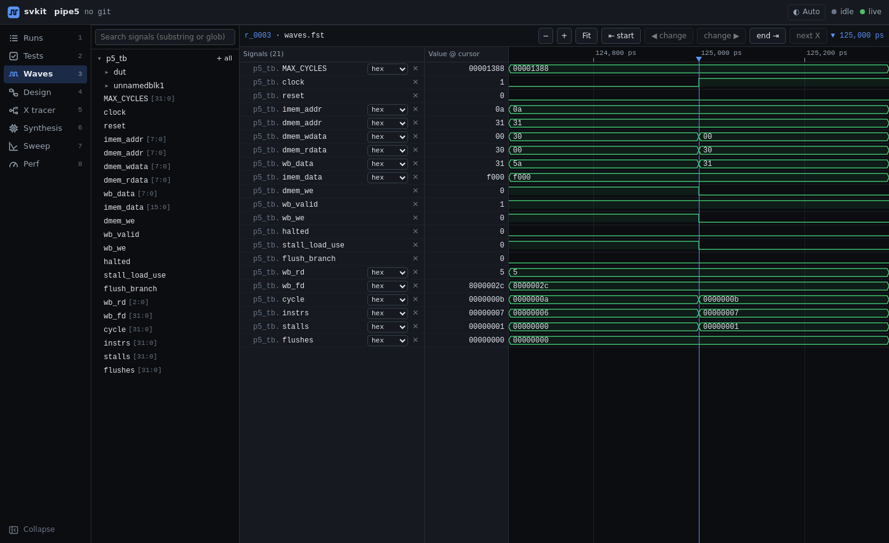
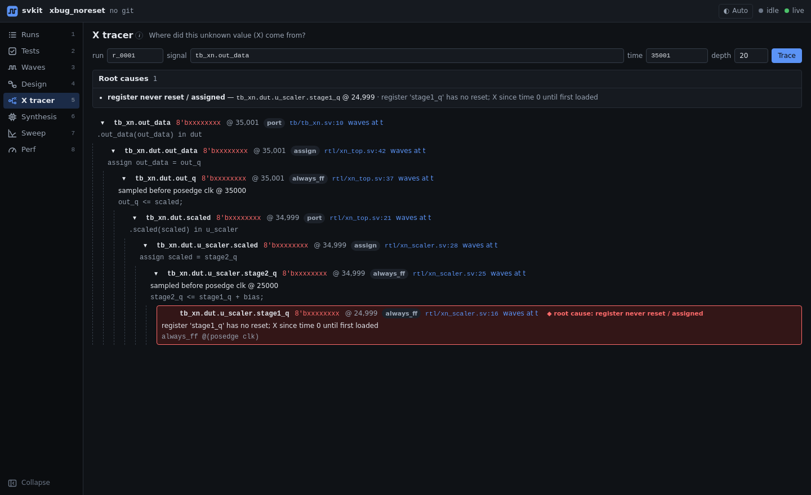
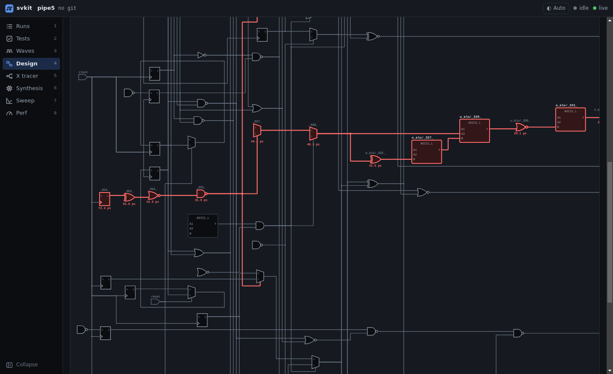
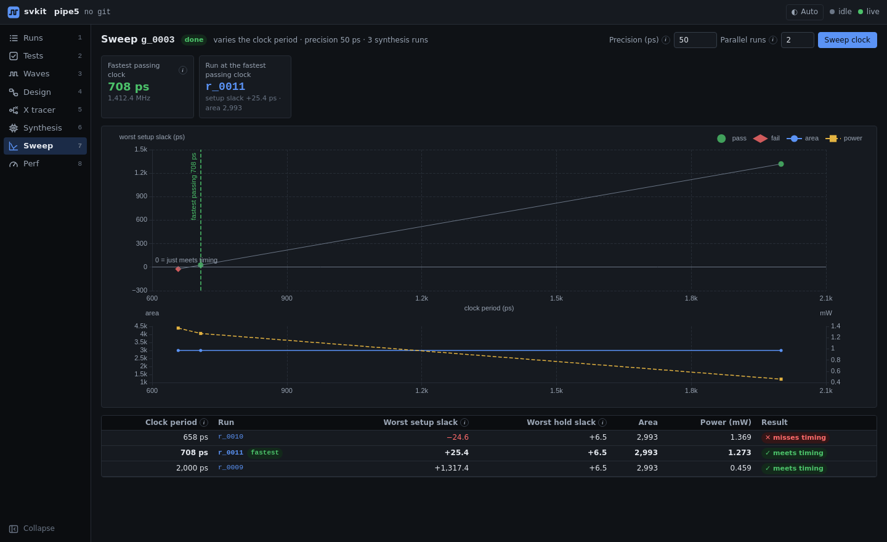
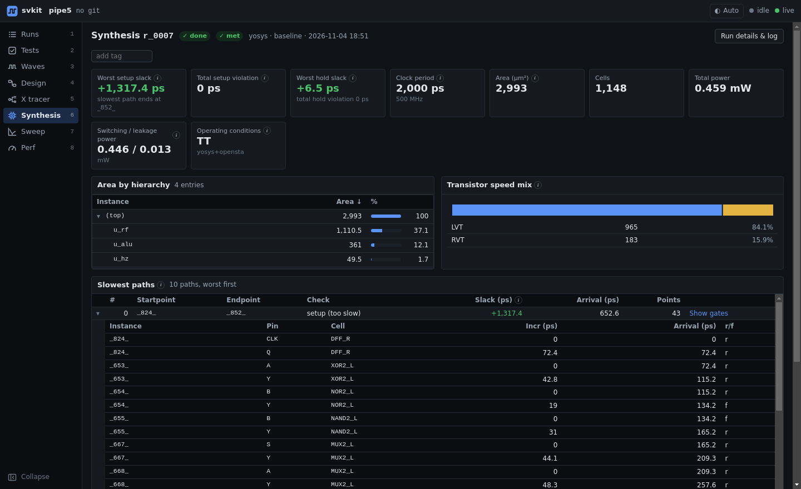
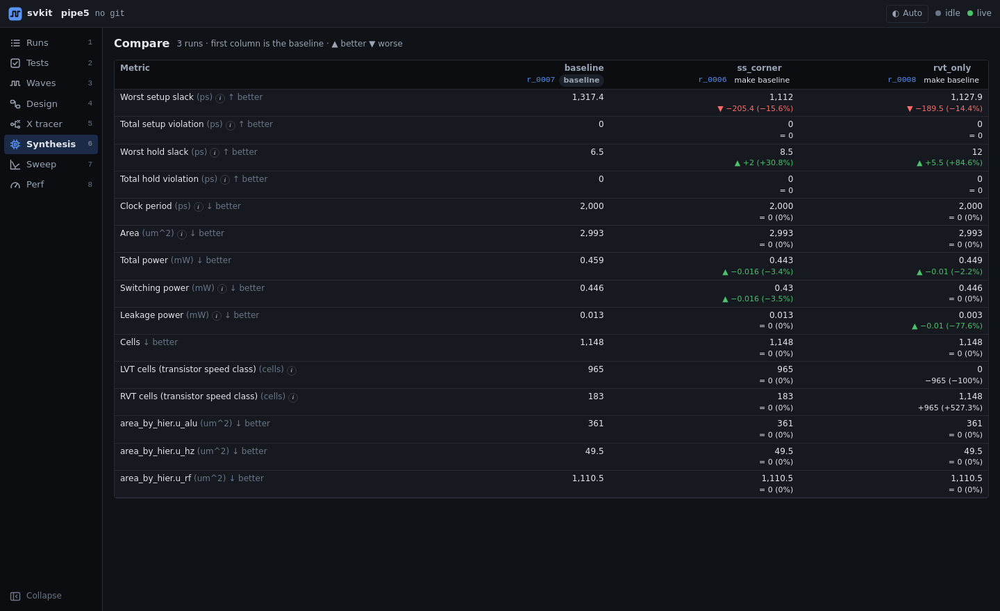

<p align="center">
  <picture>
    <source media="(prefers-color-scheme: dark)" srcset="docs/assets/svkit-banner-dark.svg">
    
  </picture>
</p>

A plug-in debug and PPA(power-performance-area) workbench for SystemVerilog projects. Add one `svkit.toml` to an existing
repo and get a local web dashboard plus a CLI for:

- **Synthesis:** QoR(Quality of Results) dashboards and an N-run compare table, for Design Compiler or Yosys + OpenSTA.
- **Experiments:** named synthesis variants (area effort, Vt mix, corner, …) run as a matrix.
- **Clock sweep:** the minimum clock period that meets timing, with a slack-vs-period chart.
- **Waveforms:** VCD/FST with struct/enum decoding, next-change / next-X, and failing tests opened
  at their first divergence from golden.
- **CPI / TPI** per test program.
- **Diagrams:** a module-level block diagram, and gate-level cones drawn as schematics (gate symbols from your Liberty cell functions) with the critical path highlighted.
- **X tracer:** `svkit xtrace` walks an X back to its root cause.

svkit **wraps your existing build** (Makefile, scripts). It never edits your Makefile or TCL and
never writes build files into your repo. Every simulation and synthesis is recorded as a *Run* in
`.svkit/`, so history and comparisons come for free.

Background: [PRODUCT.md](PRODUCT.md) (spec), [docs/MVP.md](docs/MVP.md) (v1 scope),
[docs/ARCHITECTURE.md](docs/ARCHITECTURE.md) (contracts), [PROGRESS.md](PROGRESS.md) (status),
[features/](features/README.md) (feature tour with screenshots).

## Sneak peek

A failing test opened at its first mismatch with golden, an X traced back to the register that was
never reset, the critical path drawn as gates, the clock sweep, and synthesis experiments compared:

<p align="center">
  
  
</p>
<p align="center">
  
  
</p>
<p align="center">
  
  
</p>

**Feature tour:** [`features/`](features/README.md) has a page per view (runs, tests, waveforms,
design diagrams, X tracer, synthesis and compare, clock sweep, CPI/TPI) with screenshots.

## Install

Requirements: Python ≥ 3.11 and a browser. No root access and no Node are needed, because the web
UI ships prebuilt.

Install straight from the project's GitHub repository,
[github.com/Mercury1565/sv-kit](https://github.com/Mercury1565/sv-kit):

```
python -m venv ~/.venvs/svkit
~/.venvs/svkit/bin/pip install "git+https://github.com/Mercury1565/sv-kit.git"
export PATH=~/.venvs/svkit/bin:$PATH
svkit --version
```

- **A specific version:** append a branch, tag or commit, e.g. `...sv-kit.git@main` or `...sv-kit.git@<tag>`.
- **Update:** run the same command with `--upgrade` (add `--force-reinstall` to rebuild the same version number).
- **Over SSH** (if you prefer your SSH key): `pip install "git+ssh://git@github.com/Mercury1565/sv-kit.git"`.
- **From a local checkout instead** (e.g. to try unpushed changes): `pip install /path/to/sv-kit`.

Tools are found on `PATH`, or through `[tools]` overrides in `svkit.toml`:

| Flow | Tools |
|---|---|
| Synopsys | `vcs`, `dc_shell-t` (plus `vcs -vpd2vcd` for VPD dumps) |
| Open source | `verilator`, `yosys` and `iverilog` from [OSS CAD Suite](https://github.com/YosysHQ/oss-cad-suite-build); OpenSTA `sta` (not in OSS CAD Suite: install it separately, e.g. the `openroad` conda package) |

Notes for shared Linux servers:

- **Synopsys licenses.** svkit never runs more than 2 `vcs` / `dc_shell-t` jobs at once per host,
  across all svkit processes. Set the cap with `SVKIT_SYNOPSYS_MAX_JOBS`. Per-flow
  `license_seats` lowers it further.
- **RHEL 9 Perl.** The OSS CAD Suite `verilator` wrapper needs Perl's `FindBin` module, which RHEL 9
  ships as a separate package. Without root, put `FindBin.pm` in a directory on `PERL5LIB`.
- **Stale `VERILATOR_ROOT`.** If one is set from an older install, unset it.
- **Network home directories (CIFS/SMB).** Building svkit from a source tree on such a
  mount fails, because SMB leaves `.__smb*` temp files in setuptools' build dirs. Installing from GitHub
  avoids this (pip builds in a temporary directory). For a local checkout, build the wheel from a copy on
  local disk (e.g. under `/tmp`) and install that. Running svkit on projects in your home directory works.

## Quick start

```
cd my-project
svkit init                      # scan the repo, write a best-guess svkit.toml; review every TODO
svkit sim --all                 # run every test; pass/fail against golden output
svkit synth --matrix            # run every [experiments] variant and print the compare table
svkit sweep clock --jobs 2      # find T_min
svkit xtrace tb.dut.result @35001
svkit serve                     # http://127.0.0.1:3572
```

Over SSH, forward the port from your laptop with `ssh -L 3572:localhost:3572 <server>`, then open
`http://localhost:3572`.

| Command | Does |
|---|---|
| `svkit init [--force]` | Detect top / testbench, sources, Makefile targets, golden dirs, the clock-period file, DC script variables, perf files. Writes `svkit.toml`. |
| `svkit sim <test> \| --all [--flow NAME] [--jobs N] [--no-cache]` | Run tests. Results are cached by (source hash, knobs). |
| `svkit synth [--flow NAME] [--set k=v ...] [--exp NAME \| --matrix] [--jobs N]` | Synthesize, optionally with knob overrides or experiments. |
| `svkit sweep clock [--tol 50] [--jobs N] [--start PS] [--flow NAME]` | Search for the minimum clock period. |
| `svkit xtrace <hier.signal> @<time> [--run ID] [--depth N] [--json]` | Trace an X to its root cause in the latest (or given) sim run's waves. |
| `svkit runs ls \| show <id> \| diff <a> <b> \| tag <id> <tag>` | Browse recorded Runs. |
| `svkit serve [--port 3572] [--host 127.0.0.1]` | Start the dashboard. |

Exit codes: 0 ok, 1 a test failed or no passing period, 2 config error, 3 tool error.

**Clock sweep.** A point passes when setup WNS ≥ 0 and hold WNS ≥ 0. Hold slack does not depend on
the clock period, so if even the loosest point meets setup but fails hold, the sweep judges points
on setup alone. It says so in its result (`criterion = "setup"`, plus a note). Fix hold in the
synthesis script (for example `set_fix_hold`) for a full result.

## `svkit.toml` reference

The authoritative definition is the pydantic model in `src/svkit/config.py`. Paths are relative to
the project root unless noted. String fields marked *template* accept `{test}`, `{top}`, `{root}`,
`{workdir}` and `{run_dir}`.

### `[project]`

| Key | Meaning |
|---|---|
| `name`, `top` | Project name, and the synthesis/design top module (required). |
| `tb_top` | Simulation top (testbench). Defaults to `top`. |
| `sources`, `tb_sources` | `{ glob = [...], filelist = "x.f", exclude = [...] }`. `tb_sources` are used for simulation only. |
| `include`, `defines` | Include dirs, and a `{ NAME = value }` table of defines. |
| `clock`, `reset` | Clock port name; `reset = { name = "reset", active = "high" \| "low" }`. |
| `workdir_exclude` | Large output dirs not copied into isolated work dirs (e.g. `["output", "build"]`). |

### `[flows.sim.<adapter>]` (`vcs`, `verilator`)

| Key | Meaning |
|---|---|
| `mode` | `"wrap"`: run your `cmd`. `"builtin"`: the adapter compiles `sources + tb_sources` itself. |
| `cmd` | *Template.* Runs one test, e.g. `"make {test}.out"`. |
| `build_cmd` | Run once, serially, before tests fan out (e.g. `"make build/simv"`). |
| `parallel` | `false` if tests can't run concurrently (e.g. a shared build dir). |
| `waves`, `log` | *Templates.* The waveform the test writes (VCD/FST; VPD is converted) and a log to keep. |
| `golden` | `{ actual, expected, ignore = [regex...], time_regex, time_unit = "ticks" \| "cycle" }`. `time_regex` captures a time or cycle from the first mismatching line, which places the waveform cursor. |
| `tests` | `{ glob = "programs/*.mem" }` (test name = file stem) and/or `{ names = [...] }`; `exclude = [...]` drops names. |
| `pass_regex`, `fail_regex` | Optional log checks. |
| `isolate`, `cwd`, `timeout_s`, `env`, `args` | Run in an isolated copy; working dir; timeout; extra environment; extra tool args (builtin mode). |
| `adapter` | The simulator (`vcs`, `verilator`, ...) when the flow key is not an adapter name, e.g. `[flows.sim.unit]`. |
| `testbench`, `top`, `sources`, `suite`, `error_regex` | Unit-test suites, below. |

#### Unit tests

Unit testbenches (one module each) form their own suite, shown on the Tests page under
**Unit tests**, apart from the system tests. Their runs have the same waveforms, logs and history:

```toml
[flows.sim.unit]
adapter = "vcs"                    # Verilator stands in when VCS is missing
mode = "builtin"
testbench = "test/{test}_test.sv"  # every matching file is one test: test/queue_test.sv -> "queue"
pass_regex = '@@@ PASSED'
fail_regex = '@@@ FAILED'
```

Each test compiles `[project].sources`, the flow's `sources` and its testbench file. The top is the
module declared in that file (or `top = "{test}_tb"`). The system testbench (`[project].tb_sources`)
is never a unit test. If the testbench does not dump a waveform itself, svkit adds a generated
module, bound into the top, that dumps every signal; your files are not edited. When a unit test
fails, **Waves at first error** opens the waveform at the time printed on the first log line
reporting a failed check (`ERROR`, `FAIL`, `mismatch`, or `error_regex`, whose group `time` captures
the time), with the testbench's signals added. `svkit init` writes this section when it finds
standalone testbenches. CLI: `svkit sim --all --flow unit`.

### `[flows.synth.<adapter>]` (`dc`, `yosys`)

| Key | Meaning |
|---|---|
| `mode`, `cmd` | As for sim, e.g. `cmd = "make synth/{top}.vg"`. |
| `script` | Your DC TCL script. Knobs edit a *copy* of it inside the isolated work dir, never the original. |
| `reports`, `netlist`, `log` | *Templates.* Report files to parse (a combined `.rep` is split by its banners), the gate netlist, the tool log. |
| `license_seats` | Concurrent runs of this flow (0 = no extra cap). |
| `sta` | Name of a `[flows.sta.<x>]` entry, for the open-source flow (Yosys has no timing). |
| `append_before` | Regex anchor where an experiment's `tcl_append` is inserted (default: end of script). |

Synthesis always runs in `.svkit/work/<run>/`, a full copy of the project. Outputs are kept under
`.svkit/runs/<run>/`. DC runs that leave unmapped logic, unresolved references or an unreadable
target library are marked as errors, even though DC itself exits 0.

`[flows.sta.opensta]` takes `sdc` (your SDC; by default svkit generates a clock-only one) and
`max_paths`.

### `[knobs]`: how svkit changes a setting

```toml
[knobs]
clock_period = { file = "cpu.clock", unit = "ps", default = 40000 }   # the sweep drives this one
corner       = { tcl_var = "corner", default = "TT" }
compile_cmd  = { tcl_replace = '^\s*compile\b.*$', with = "{value}" }   # --set compile_cmd=compile_ultra
```

| Mechanism | Effect, always inside the run's work dir |
|---|---|
| `file = "path"` | Write the value to that file. |
| `env = "NAME"` | Export an environment variable. |
| `tcl_var = "name"` | Set the variable at the top of the script copy. Your own `set name default` line is guarded so the knob wins. |
| `tcl_replace = "regex", with = "..."` | Regex replacement in the script copy (last resort; errors if nothing matches). |
| `tcl_append = true` | Append the value as TCL (before the `before` regex, if given). |
| `define = "NAME"` | A Verilog define for simulation. |

Other keys: `unit` (time knobs; svkit works in ps), `format`, `default`, and `applies_to` (default
`["synth", "sta"]`).

### `[experiments]`, `[perf]`, `[library]`, `[tools]`, `[server]`, `[waves]`

```toml
[experiments]                     # svkit synth --exp NAME / --matrix
baseline   = {}
ss_corner  = { corner = "SS" }
max_fanout = { tcl_append = "set_max_fanout 8 [current_design]" }

[perf.source]                     # CPI = cycles / instrs; TPI = CPI x clock period
regex_file = "output/{test}.cpi"
cycles = '(\d+)\s*cycles'          # one capture group each
instrs = '(\d+)\s*instrs'
stalls = { load_use = 'load-use stalls\D*(\d+)' }   # optional

[library]
vt_suffix = { "_R" = "RVT", "_L" = "LVT", "_SL" = "SLVT" }   # cell-name suffix -> Vt class (longest wins)
liberty = ["lib/tt.lib"]                                      # open-source flow; also gives the Gates view its symbols
corners = { TT = ["lib/tt.lib"], SS = ["lib/ss.lib"] }

[tools]                           # executable overrides
sta = "/opt/openroad/bin/sta"

[server]
port = 3572

[waves]
max_size_mb = 2000                # don't archive larger dumps
archive = "fst"                   # default; "vcd" keeps plain-text VCDs
```

**Waveform storage.** svkit keeps a copy of each run's waveform under `.svkit/runs/`, because your
build overwrites its own output files on the next run. By default the copy is stored as **FST**,
converted with `vcd2fst` (part of GTKWave and OSS CAD Suite). That is typically 20–60× smaller
than VCD, takes well under a second per run, and loses nothing (the converted file is checked
before the VCD is dropped). Your own `output/*.vcd` files are never touched. If `vcd2fst` is
missing or a conversion fails, the VCD is kept and the run says why. To go back to VCD, for
example to open svkit's copies in Verdi or read them as text:

```bash
# 1. new runs: in svkit.toml
#    [waves]
#    archive = "vcd"
# 2. runs already recorded (uses fst2vcd; --dry-run lists them first):
svkit waves archive --to vcd
```

`svkit waves archive --to fst` does the reverse, for example to shrink a project recorded before
FST became the default (lab7: 607 MB of VCDs became 17 MB).

## Adding an adapter

Adapters run a tool and normalize its output to the shared schemas in `src/svkit/schemas.py`
(`SimResult`, `SynthResult`, `TimingPath`, …). The UI and the analyses only ever see those
schemas, so a new adapter needs no UI work.

1. Subclass `SimAdapter`, `SynthAdapter` or `StaAdapter` from `svkit.adapters.base`. Set `name`
   and `tools`, and implement `run()`. A synthesis adapter also implements `parse(files, top=...)`
   so it can be tested against golden report files without the tool.
2. Use the `RunContext`:
   - `ctx.sh(cmd)` runs commands, niced and cancellable, with the output streamed to the live log.
   - `ctx.keep(path, name)` stores artifacts. Keep the waveform as `waves.vcd`/`waves.fst`, logs as
     `sim.log`/`synth.log`, and the netlist as `netlist.v`.
   - Never write outside `ctx.workdir` / `ctx.run_dir`.
3. Sim adapters decide pass/fail with `svkit.core.golden.evaluate()`, so every flow behaves the same.
   Synthesis adapters fill `vt_mix` with `svkit.analysis.vt.vt_mix()`.
4. Register the adapter from your own package:
   ```toml
   [project.entry-points."svkit.adapters"]
   mysim = "my_pkg.mysim:MySimAdapter"
   ```
   It is then usable as `[flows.sim.mysim]`.
5. Add golden-file tests: real tool output plus the expected normalized JSON. See
   `tests/test_dc_reports.py` and `fixtures/golden/`.

## Development

```
python3.11 -m venv .venv && .venv/bin/pip install -e '.[dev]'
.venv/bin/pytest -q                 # tool-dependent tests skip when the tools are missing
.venv/bin/pytest -m synopsys        # real VCS/DC runs (needs SVKIT_DC_TARGET_LIB or SVKIT_DC_LIBERTY)
.venv/bin/pytest -m oss             # real Verilator/Yosys/OpenSTA runs
```

- **DC library setup** for the fixtures: see `fixtures/synopsys_common/README.md`.
- **Web UI:** React + TypeScript in `web/`. Rebuild with `cd web && npm ci && npm run build`, which
  needs a modern Node and writes to `src/svkit/server/static/`. Commit the built assets.

## Known limitations

- The X tracer models standard Verilog X semantics. VCS `-xprop=tmerge` is not modelled.
  Verilator is 2-state and never shows X, so trace X on waves from a 4-state simulator (VCS).
- The golden-diff jump needs output lines that carry a time or cycle (`golden.time_regex`).
  Final-state dumps, such as a memory image sorted by address, cannot be placed in time.
- See [PROGRESS.md](PROGRESS.md) for current gaps.
