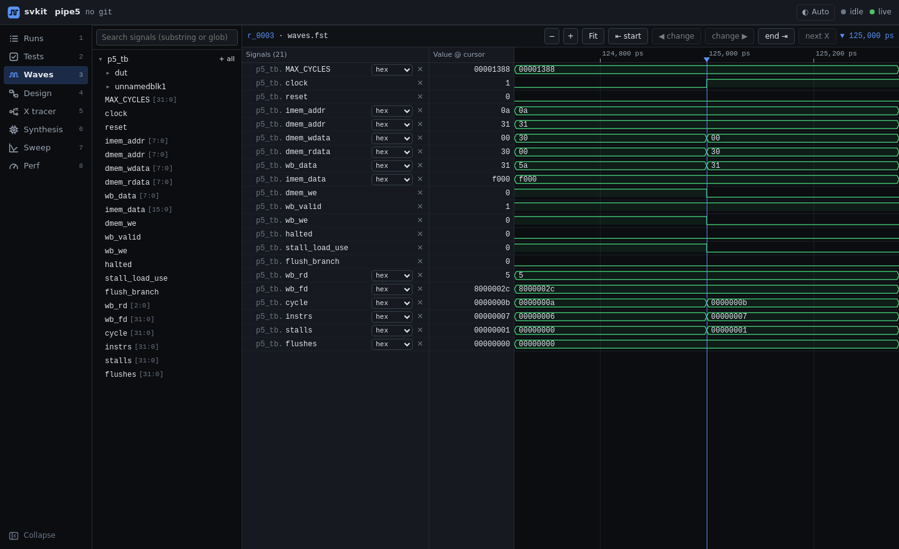
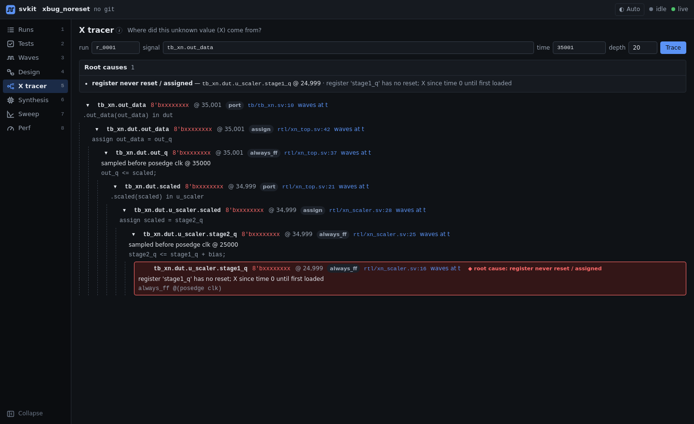
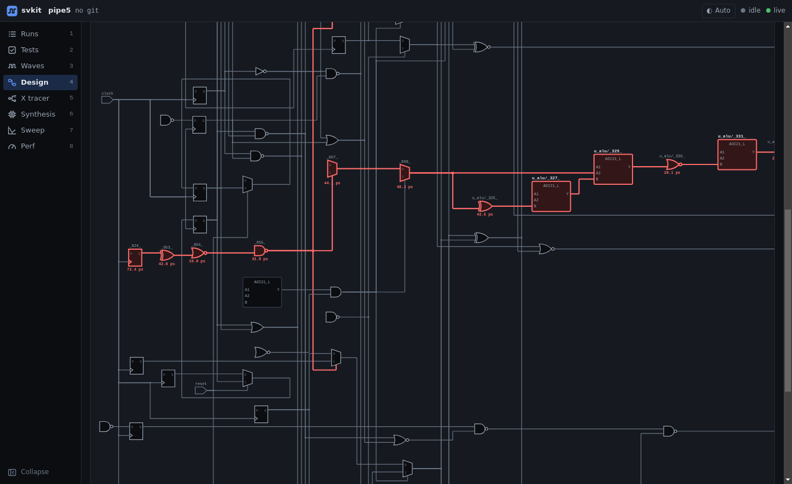

# svkit features

A high-level tour of what svkit does, one page per view. Each page says what the view is for, what it
shows, and how to get there from the CLI. The screenshots are from svkit running on the fixture designs
in [`fixtures/`](../fixtures) (`pipe5`, a small 5-stage pipeline, and `xbug_noreset`, an X-propagation
bug). They show the open-source flow (Verilator + Yosys + OpenSTA). The Synopsys flow (VCS + DC) feeds
the same views.

| Feature | What it answers | Page |
|---|---|---|
| **Runs** | What ran, when, with which settings, and did it pass? | [runs.md](runs.md) |
| **Tests** | Which tests fail, and where does the first failure start? | [tests.md](tests.md) |
| **Waveforms** | What did the signals do around the failure? | [waves.md](waves.md) |
| **Design diagrams** | How is the design wired, and which gates are on the critical path? | [design.md](design.md) |
| **X tracer** | Where did this unknown value (X) come from? | [xtrace.md](xtrace.md) |
| **Synthesis and compare** | How big, fast and power-hungry is it, and how did a change move the numbers? | [synthesis.md](synthesis.md) |
| **Clock sweep** | What is the fastest clock the design meets timing at? | [sweep.md](sweep.md) |
| **Performance (CPI / TPI)** | How many cycles, and how much time, does each program take per instruction? | [perf.md](perf.md) |

  
  
  

## How the pieces fit

1. Add a `svkit.toml` to your project (`svkit init` writes a first guess). svkit **wraps your existing
   build** and never edits your Makefile or TCL.
2. `svkit sim`, `svkit synth` and `svkit sweep clock` run your tools and record every result as a
   **Run** in the project's `.svkit/` folder.
3. `svkit serve` opens the dashboard. Every view reads the same recorded Runs, so the views link to each
   other: a failing test opens its waveform, a timing path opens its gates, an X opens the waveform at
   the moment it appeared.

## Shared across every view

- **Both toolchains.** VCS + Design Compiler and Verilator + Yosys + OpenSTA results are normalized to
  the same schema, so every view works the same way with either flow.
- **Live updates.** Runs started from the CLI or the dashboard appear without a reload.
- **Keyboard first.** Keys `1`–`8` switch views and `[` collapses the sidebar to an icon rail. The
  waveform view has its own shortcuts (see [waves.md](waves.md)).
- **Light and dark themes.** Follows your OS by default; the header switch picks Auto, Light or Dark.
- **No setup in the browser.** The web UI ships prebuilt inside the Python package: no Node, no root.
  Over SSH, forward the port that `svkit serve` prints (`ssh -L <port>:localhost:<port> <host>`).
