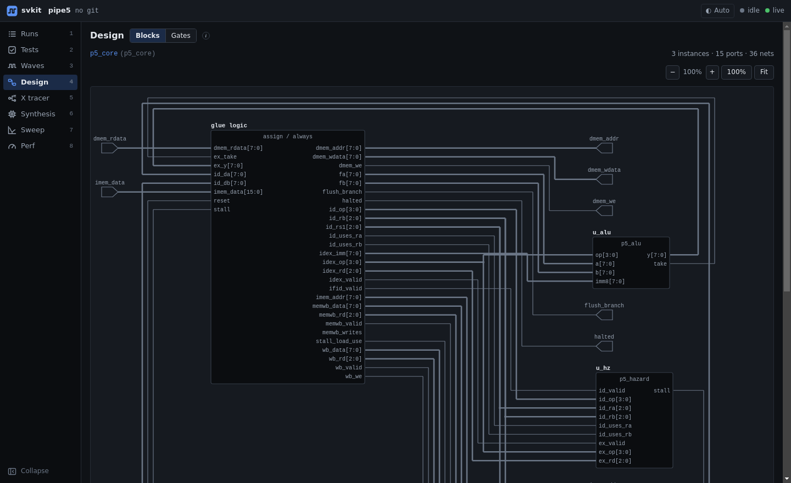
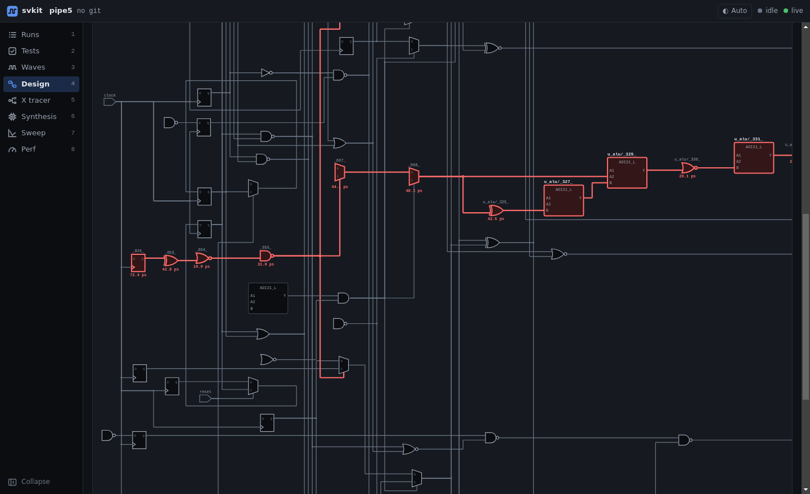

# Design diagrams

Two schematic views of your design, drawn in the browser with
[netlistsvg](https://github.com/nturley/netlistsvg) and svkit's own symbol set.

## Blocks

A block diagram of one module: its sub-module instances as boxes with their ports, the module's own
`assign`/`always` logic as one "glue logic" box, and the wires between them. It is built from your RTL
sources (no synthesis needed). Click an instance to open that module; the breadcrumb takes you back up.

## Gates

The gate-level logic around one timing path of a synthesis run: the cells on the path and the cells
that feed them, up to the depth you choose. The **critical path is highlighted** in red, with each cell's
delay under it.

- Cells are drawn as real gate symbols (AND, NAND, OR, NOR, XOR, XNOR, inverter, buffer, mux, flip-flop,
  latch). svkit picks the symbol from the cell's `function` in your Liberty library, so it works with
  any standard-cell library, not just a known list of cell names.
- Complex cells (AOI, OAI, adders, ...) are drawn as boxes with their pin names.
- Open it from a synthesis run's *Show gates* button on any timing path, or from the Gates tab (which
  opens the latest synthesis run's worst path).

## Working with large diagrams

- Ctrl / ⌘ + scroll (or pinch) zooms around the cursor; the `+` / `−`, 100% and Fit buttons do the same.
- Layout runs in a background thread, so the page stays responsive while a large cone is drawn.
- Hover any cell or instance for its full name, type and delay.
