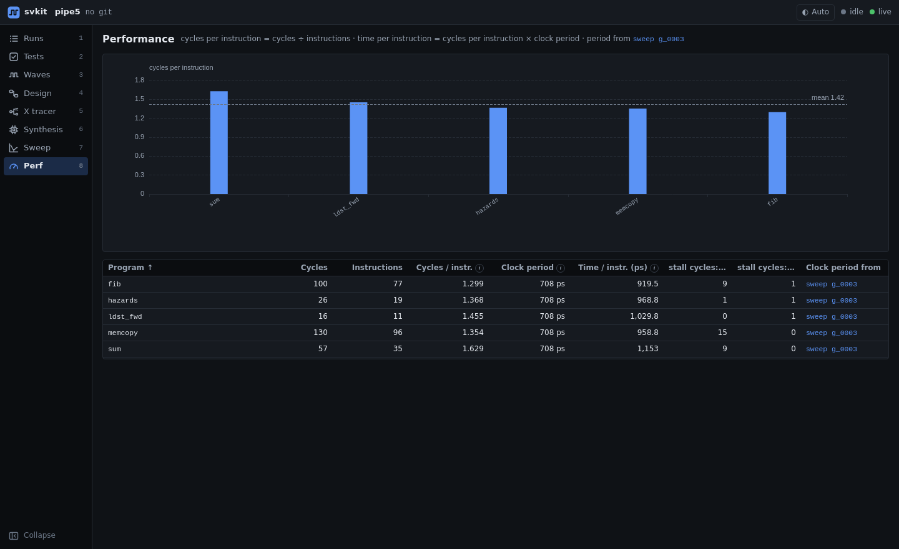

# Performance (CPI / TPI)

For processor designs: cycles per instruction (CPI) for every test program, and time per instruction
(TPI), which combines CPI with the clock period synthesis can actually reach.



## What it shows

- **A chart per program**, with the mean. Switch it between **cycles per instruction** (CPI),
  **instructions per cycle** (IPC = 1 / CPI) and **time per instruction** (TPI; available once a clock
  period is known). Bars are sorted worst first.
- A table per program: cycles, instructions, CPI, clock period, **TPI = CPI × clock period**, and stall
  counts by cause (for example load-use stalls and branch flushes).
- **Each run keeps the clock period it finished with.** When a test run finishes, svkit stores its
  clock period, and that run's TPI never changes after that: not when you pick another source below,
  edit `svkit.toml`, or run a new sweep or synthesis. The table names where each run's period came
  from (sweeps and synthesis runs are linked so you can check them).
- **Clock period for new runs**, at the top, sets the period that runs finishing from now on get:
  - **svkit.toml** (the default): the `clock_period` knob's `default`, or, when that is not set, the
    latest synthesis run.
  - **Clock sweep**: the latest clock sweep's T_min (see [sweep.md](sweep.md)), else the latest
    synthesis run.
  - **Enter it…**: a period you type in (ps), applied when you press Enter. It starts from the period
    a run would get at that moment.

  Next to it you see the period a run finishing now would get. The choice is saved with the project,
  so it is the same for everyone using the dashboard and for `svkit sim` on the command line.
- Runs recorded by svkit before v0.14 had no stored period. The first time svkit shows one, it gives
  it the period from the rule svkit used before v0.12: the clock sweep's T_min in effect when the run
  was made, else the synthesis period in effect then. That period is then stored and stays.

## One test across runs

Click a program in the table (or pick it from *See one test across runs…*) to see how its numbers
changed over every run of it: two bar charts, **cycles per instruction** and **time per instruction**,
one bar per run, oldest on the left. Each run has its own color, the same in both charts, and is
labelled with its batch name (or run name, or id) and date. A table below repeats the numbers with the
change from the previous run (red when it got worse, green when it got better). Click a bar to open
that run.

- Eight runs are shown at a time; *‹ Older* and *Newer ›* page through the rest.
- Time per instruction uses the clock period each run finished with, so a faster clock from a later
  design revision shows up in TPI.
- Each chart has its own *Save image (PNG)*.

## Export

- **Save image (PNG)** saves the chart as it is switched (CPI, IPC or TPI), with every program in it
  even when the chart is zoomed, at twice screen resolution, titled with the batch it shows.
- **Download CSV** saves the table: one row per program with raw numbers (cycles, instructions, CPI,
  IPC, clock period, TPI, stall counts, where the period came from). It opens in any spreadsheet.

File names say what they hold, for example `perf-g_0004-after-the-fix-tpi.png` or `perf-latest.csv`.

## Batches: run the tests you choose, under a name

Each run of several tests is a **batch**. The dropdown at the top lists every batch, newest first,
and shows that batch's numbers on their own; *Latest result per test* mixes the newest result of
every test across all runs.

- **Run tests…** opens a list of your tests with checkboxes (filter, select all, select none). Pick
  the ones you want, give the batch a name if you like (for example `after the branch predictor fix`),
  and run them. The page switches to the new batch when it finishes. Your choice of tests is
  remembered for next time.
- **Rename a batch** with the pencil next to its name (or *+ Add a name*). Names show in the dropdown.
- **Remove a batch** you ran by mistake: pick it in the dropdown, then *Remove batch*. svkit asks once,
  then deletes that batch's runs and their files; other batches are not touched. A batch with tests
  still running is kept until they finish or are cancelled.

From the CLI:

```
svkit sim fib gcd copy --name "after the fix"   # these tests, as one named batch
svkit sim --all --name nightly                  # every test
svkit rename g_0004 "before the fix"            # name (or rename) a batch later
svkit runs rm g_0005                            # remove a batch and its runs (asks first)
```

## Setup

Your testbench already prints its counters; tell svkit where to find them in `svkit.toml`:

```toml
[perf.source]
regex_file = "output/{test}.cpi"
cycles = 'cycles\s*=\s*(\d+)'
instrs = 'instrs\s*=\s*(\d+)'
stalls = { load_use = 'load_use_stalls\s*=\s*(\d+)', branch = 'branch_flushes\s*=\s*(\d+)' }
```

By default, runs take their clock period from `svkit.toml` (in ps) as they finish:

```toml
[knobs]
clock_period = { file = "clock_period.txt", unit = "ps", default = 2000 }
```

To have new runs use a sweep's result or a period of your own instead, pick it under *Clock period
for new runs*, or from the CLI:

```
svkit perf period          # show where new runs take their clock period from
svkit perf period sweep    # the latest clock sweep's T_min
svkit perf period 850      # 850 ps
svkit perf period toml     # back to svkit.toml
```

Runs that already finished keep their period either way. svkit reads `svkit.toml` when it starts, so
restart `svkit serve` after editing it.
