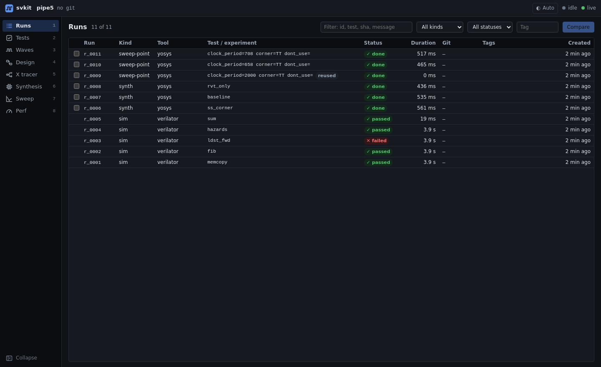

# Runs

Every simulation, synthesis and sweep point svkit starts is recorded as a **Run**: the command, the
settings (knobs) it used, the git commit and dirty state, its log, its outputs (waves, reports,
netlists) and the parsed results. Runs are stored per project in `.svkit/`, so history and comparisons
need no extra bookkeeping.



## What you can do

- **See everything that ran**, newest first: kind (sim, synth, sweep point), tool, test or experiment,
  status, duration, git commit, tags and your own name for the run.
- **Filter** by text (id, name, test, commit, message), kind, status or tag.
- **Spot reuse.** A sweep point that matches an earlier run is marked `reused` instead of being rerun.
- **Compare** two or more synthesis runs: tick them and press Compare (see [synthesis.md](synthesis.md)).
- **Open a run** for its details: settings, log, output files, and links to the views that show it.
- **Name** a run (`+ Add a name` or the pencil on its page) so you can find it later, and **tag** runs
  you want to keep track of, such as a baseline.

## From the CLI

```
svkit runs ls                 # list recorded runs
svkit runs show r_0007        # one run's settings, results and files
svkit runs diff r_0007 r_0008 # what changed between two runs
svkit runs tag r_0007 baseline
svkit rename r_0007 "first clean synth"   # your own name; also works for batches (g_0004)
```
