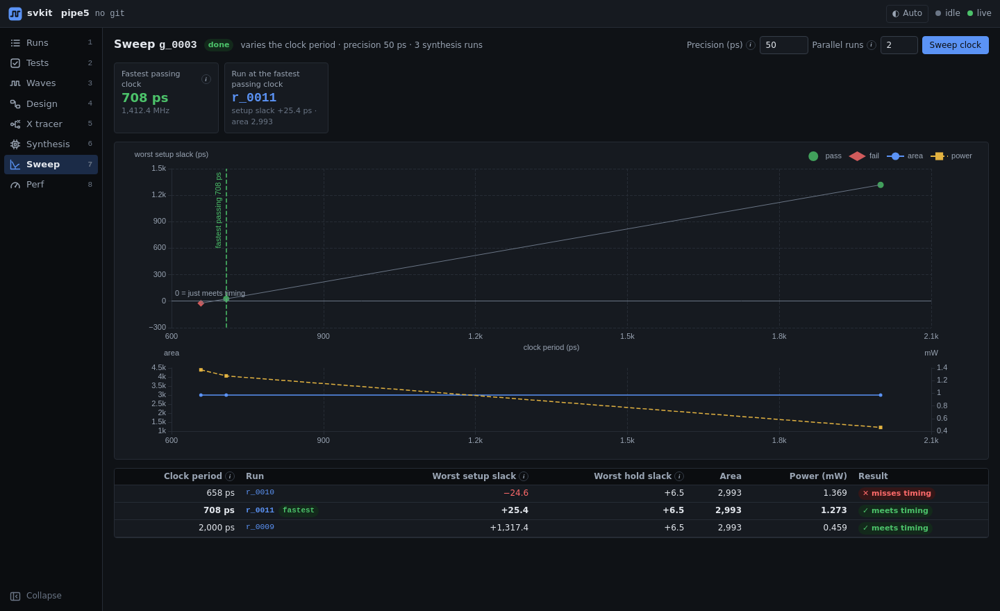

# Clock sweep

Finds the fastest clock your design meets timing at (**T_min**), by running synthesis and timing at
different clock periods and narrowing in on the boundary between pass and fail.



## What it shows

- **The answer first**: the fastest passing period and its frequency, and the run at that period.
- **Slack vs. clock period**: passing and failing points, the zero-slack line, and T_min marked.
- **Area and power vs. clock period**, so you can see what a faster clock costs.
- **Every point** in a table, linked to its synthesis run.

## How it works

- Starts from a known period, then searches until the gap between the fastest pass and the slowest fail
  is within the precision you set (for example 50 ps).
- Pass means setup **and** hold timing are met.
- Runs several points in parallel (`--jobs`), within the license cap for Synopsys tools.
- Reuses results: a period that was already run with the same settings is not run again.
- The period is applied through the knob you configure (a file, a TCL variable or an environment
  variable); your scripts are not edited.

## From the CLI or the dashboard

```
svkit sweep clock --tol 50 --jobs 2      # also: --start <ps>, --flow <name>
```

The *Sweep clock* button on this page starts the same search.
