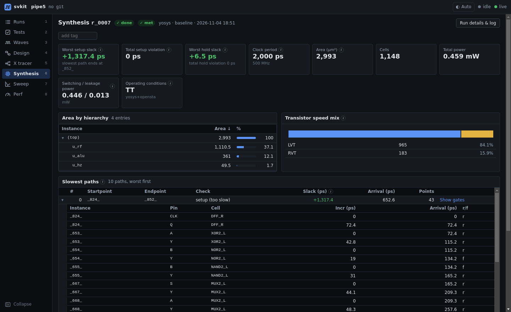
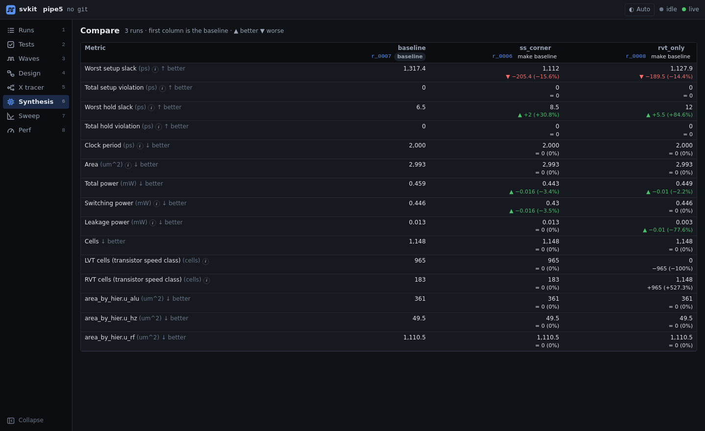

# Synthesis and compare

Synthesis results (QoR: quality of results) from Design Compiler or from Yosys + OpenSTA, parsed into
one shared format and shown as a dashboard instead of report files.



## One run

- **Headline numbers**: worst and total setup slack, worst hold slack, clock period and frequency,
  area, cell count, total / switching / leakage power, operating corner.
- **Area by hierarchy**: which sub-modules take the area, as a sortable tree.
- **Transistor speed mix**: how many cells of each threshold-voltage class (for example LVT and RVT),
  from the cell-name suffixes you configure.
- **Slowest paths**: the worst timing paths, each expandable to every point (instance, pin, cell,
  incremental delay, arrival). *Show gates* draws the path as a schematic (see [design.md](design.md)).

## The list of runs

The Synthesis page lists every synthesis run (and sweep point) with its headline numbers: clock
period, worst setup slack (red when negative; hover for the hold slack), area, total power and cell
count. Click a column header to sort by it, again to reverse, a third time to go back to the order the
runs were made (newest first). Runs without results yet sort last. The name column sorts by name.

## Remove runs

Tick the runs you no longer want in the list and click **Remove**. svkit asks once, then deletes the runs
and their files; it cannot be undone. Runs still queued or running are kept. If another run *reused* a
removed run's result, it keeps working: it takes over the files. Removed run ids are never given to new
runs. From the CLI: `svkit runs rm r_0012 r_0013` (add `-y` to skip the question).

## Download a run's reports

**Download reports (.txt)** on a run's page (or the `.txt` link in its row of the list) saves one text
file holding:

1. svkit's summary of the run: name, tool, knobs, clock period, setup and hold slack, area, cells,
   power and the worst timing paths. These are the same numbers on every flow.
2. Every text report the run kept, verbatim, each under its file name: Design Compiler's `.rpt` /
   `.rep` reports, Yosys's `stat.txt`, OpenSTA's timing output, or the reports your own flow writes.

Reused (cached) runs export the reports of the run they reuse. Netlists, scripts and logs are not
included; open those from *Run details & log*.

## Names

Give a run a name you will remember (`retimed ALU, ss corner`): type it in *Name (optional)* before
you click *Run synthesis*, or add or change it later with the pencil on the run's page. Names show in
the runs table, are searchable on the Runs page, and label the columns of the compare table.

```
svkit synth --exp ss_corner --name "retimed ALU, ss corner"
svkit rename r_0012 "retimed ALU, ss corner"
```

## Experiments

Name variants of your synthesis settings in `svkit.toml` (another corner, a dont-use list, a different
compile command, ...) and run them all at once:

```
svkit synth --matrix      # runs every [experiments] entry and prints the compare table
```

svkit applies each setting without editing your scripts (TCL variables, appended lines, files or
environment variables, per flow).

## Compare

Pick two or more synthesis runs (on the Runs or Synthesis page) to see them side by side. The first
column is the baseline; every other cell shows the change from it, marked better or worse in the
direction that matters for that metric (less area is better, more slack is better). Any run can be made
the baseline.



- **Basic / Advanced.** *Basic* (the default) shows the headline rows: setup and hold slack, clock
  period, area, power and **Cells**. *Advanced* adds everything else: cells per transistor speed class
  (HVT / RVT / LVT) and area per top-level block. svkit remembers your choice.
- **Save image (PNG)** saves the table as shown (Basic or Advanced) as a picture, with the
  better / worse colors and arrows, for slides or a report.
- **Download CSV** saves the rows shown with raw numbers: each run's value, and for every run after the
  baseline its change, change in percent and verdict (better / worse / same).
