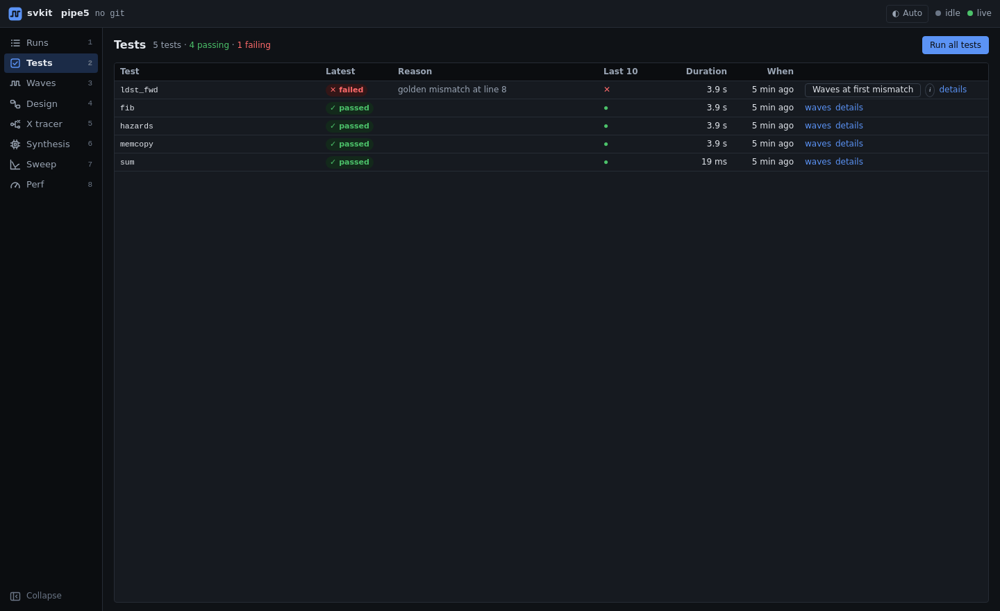

# Tests

One row per test, with its latest result. svkit decides pass or fail by comparing the test's output with
its golden file (or by the pass/fail patterns you configure), and remembers the reason.



## What you can do

- **See the state of the suite at a glance**: passing and failing counts, the reason for each failure
  (for example `golden mismatch at line 8`), and the last 10 results of every test.
- **Jump straight to the failure.** *Waves at first mismatch* finds the first output line that differs
  from golden, maps it to a simulation time, and opens the waveform there (see [waves.md](waves.md)).
  This needs output lines that carry a time or cycle (`golden.time_regex` in `svkit.toml`).
- **Run tests from the dashboard**: *Run all tests*, or *Run* on a test that has not run yet.
- **Unit-test suites** (for example per-module testbenches) get their own tab; for those, svkit opens the
  waveform at the first error printed in the log.

## From the CLI

```
svkit sim fib                 # one test
svkit sim --all               # every test; exit code 1 if any fail
```
