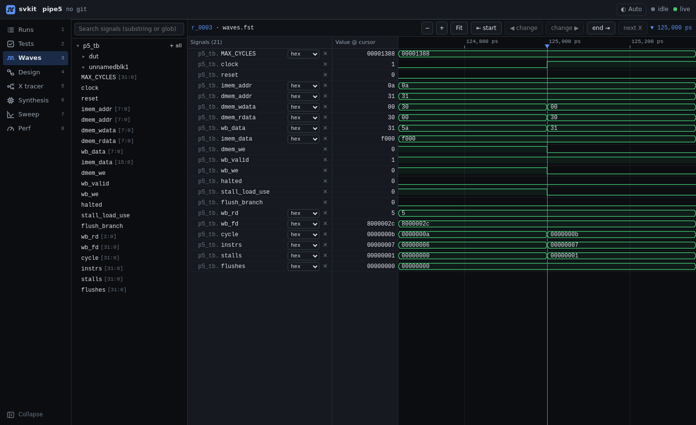

# Waveforms

A fast waveform viewer for the VCD and FST files your simulations write, built into the dashboard.
Every simulation run keeps its waveform, so you can open any past run, not just the latest one.



## What you can do

- **Open a failing test at its first divergence** from golden, with the cursor already there (from the
  Tests view or a run's page).
- **Browse the design hierarchy** in the left tree, or search signals by substring or glob, and add
  them one by one or a whole scope at a time.
- **Read values your way**: hex, binary, decimal, signed, or enum names. Packed structs expand into
  their fields, and enums show their names, decoded from your SystemVerilog source.
- **Move through time by events** instead of scrolling: next / previous change of the selected signal,
  next / previous X, start and end.
- **Measure**: drop a marker and read the time between marker and cursor.
- **Resize the columns.** Drag the borders of the signal tree, the signal names and the value column
  (or focus a border and use ←/→); double-click resets. The waveform takes the remaining width.

## Keyboard

| Key | Does |
|---|---|
| `+` / `-` | zoom in / out |
| `f` | fit the whole run |
| `→` / `n`, `←` / `p` | next / previous change of the selected signal |
| `x` / `X` | next / previous X |
| `Home` / `End` | go to start / end |
| `↑` / `↓` | select the previous / next signal |
| `m`, `Esc` | set marker, clear marker |
| `Delete` | remove the selected signal |

## From the CLI

```
svkit waves archive --to fst  # shrink kept waveforms of recorded runs (or --to vcd); --dry-run lists them
```
