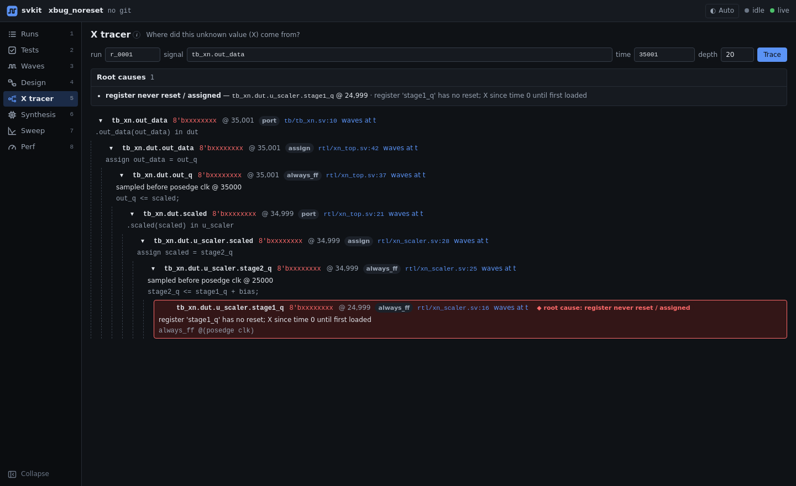

# X tracer

When a signal goes X (unknown), the X tracer walks backwards through the design, through assignments,
registers and module ports, until it reaches the place the X was born, and says why.



## What it shows

- A **tree** from the signal you asked about down to the root cause. Each step names the signal, its
  value and time, the kind of step (port, assign, always_ff, ...) and the source line, with a link to
  the waveform at that moment.
- The **root cause**, highlighted, with a plain-language explanation.

## Root causes it pinpoints

| Class | Example |
|---|---|
| Register never reset or never assigned | a pipeline register with no reset that is read before it is first loaded |
| Uninitialized memory or out-of-range index | a register-file entry read before it is written; a 3-bit index into a 6-entry table |
| X or Z from outside the design | a top-level input the testbench leaves undriven |

Each class has a fixture with a planted bug (`fixtures/xbug_noreset`, `xbug_mem`, `xbug_input`), and the
tests check that the tracer finds exactly the planted root cause.

The tracer needs a 4-state simulation (VCS, or another 4-state simulator such as Icarus Verilog), because
2-state simulators like Verilator never produce X.

## From the CLI

```
svkit xtrace tb.dut.result @35001            # latest sim run
svkit xtrace tb.dut.result @35001 --run r_0012 --depth 30 --json
```
